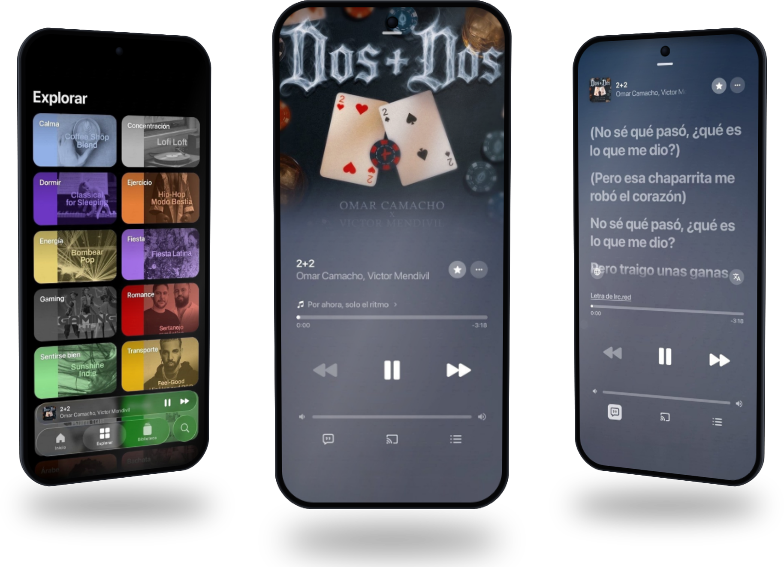
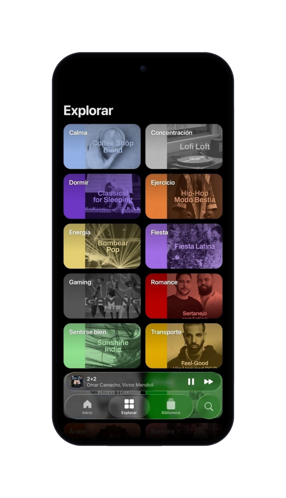
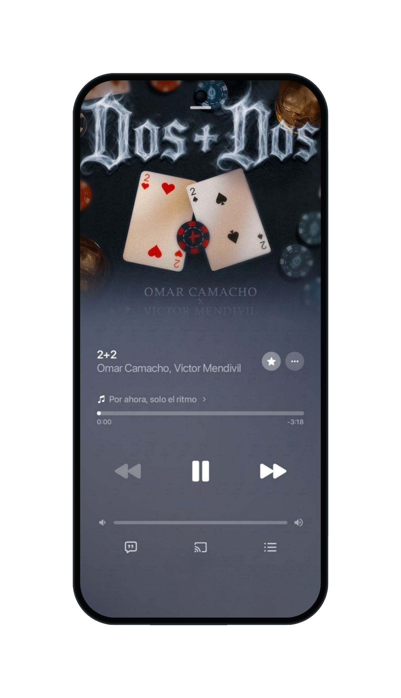
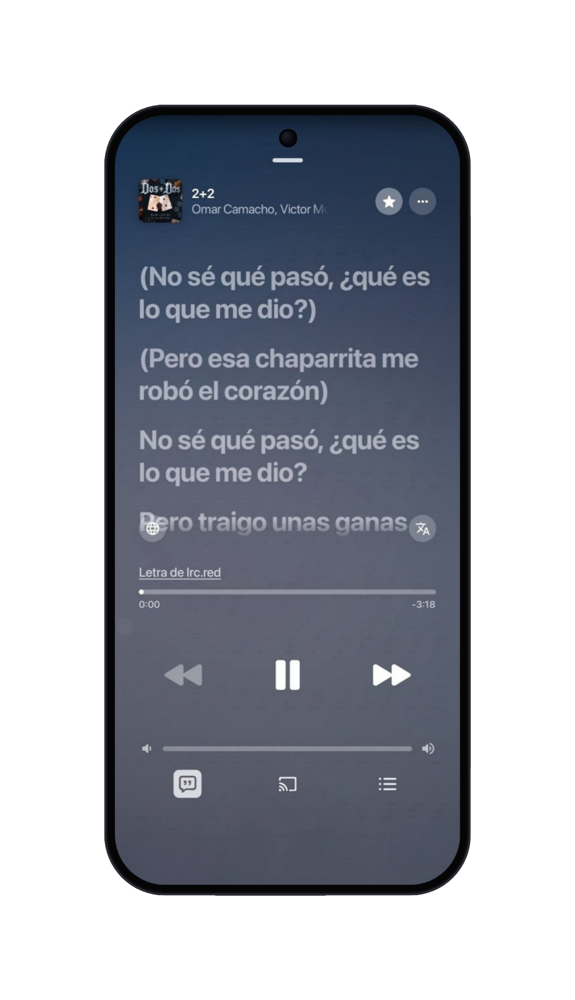

# Melodix
Un reproductor de música para Android, con diseño cuidado y colores que cambian con cada canción.

## ¿Qué es Melodix?
Melodix es una aplicación de música para Android que se conecta a YouTube Music y la presenta con una interfaz propia: limpia, en español y con mucho cuidado visual.

## Capturas

